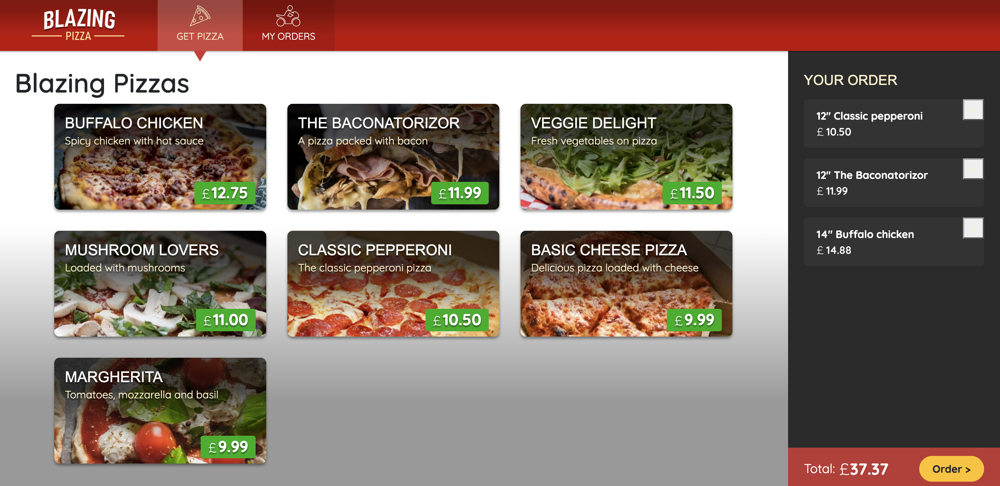
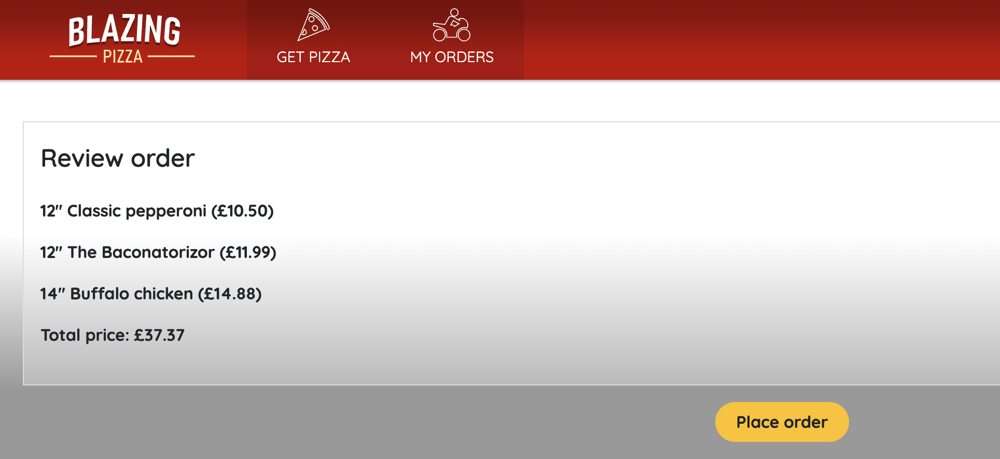
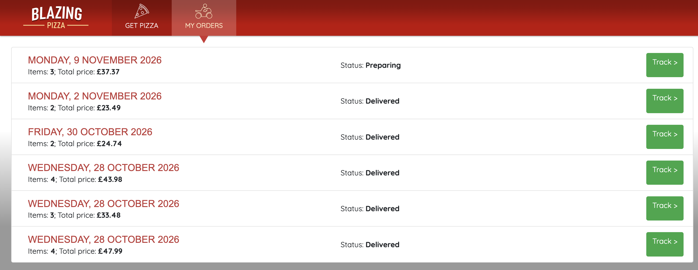
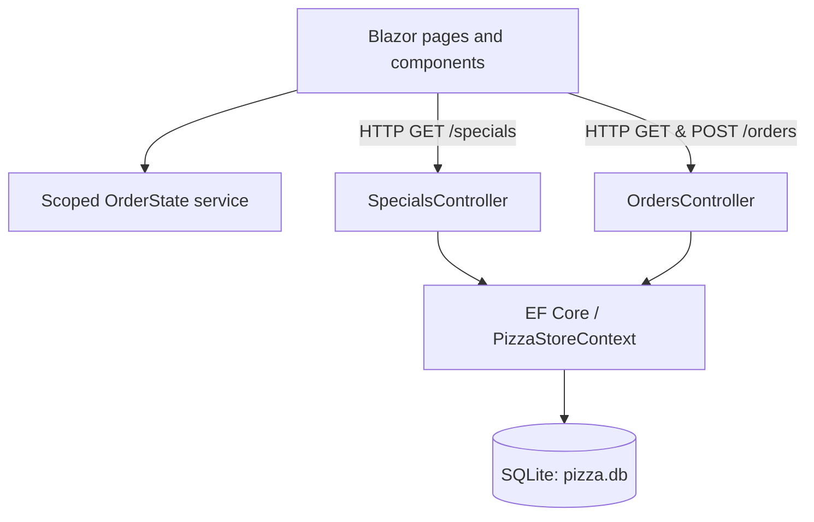

# 🍕 BlazingPizza

**A full-stack pizza ordering demo built with C#, ASP.NET Core Blazor Server, Entity Framework Core, and SQLite.**

Browse a pizza menu, customize an order, manage a shopping cart, enter a validated delivery address, and follow an order from checkout to a simulated delivery status all in one interactive web app.


<!-- SCREENSHOTS: Add your own real application capture at docs/screenshots/pizza-menu.png before publishing. -->


> **Portfolio project:** Built while working through Microsoft's [Build web apps with Blazor](https://learn.microsoft.com/en-us/training/paths/build-web-apps-with-blazor/) learning path. I adapted the tutorial application for **.NET 10**, developed it in **JetBrains Rider on macOS**, and organized the code into separate pages, services, controllers, and data-access folders. This is a learning application, not a commercial ordering service.

## What it does

- **Browse the menu:** Load pizza specials from an ASP.NET Core endpoint backed by SQLite.
- **Customize pizzas:** Choose a pizza size and toppings; see the calculated price update as you configure it.
- **Manage a cart:** Add or remove configured pizzas and see an up-to-date order total using a dependency-injected `OrderState` service.
- **Check out:** Review the order, enter delivery details, and submit using a Blazor form with data-annotation validation and inline feedback.
- **Save orders:** Send order data to an ASP.NET Core controller that persists orders and their related pizzas with Entity Framework Core.
- **Track orders:** View order history and open individual order details through typed route parameters. Delivery states are **simulated**, not live courier tracking.
- **Navigate consistently:** Share a single layout and `NavLink` navigation across the application.

## Screenshots

Three screens from the running application show the core ordering journey.

### 1. Pizza menu and shopping cart

The menu loads pizza specials from SQLite, while the cart shows selected pizzas, sizes, prices, and the order total.

*Shown in the overview screenshot above.*

### 2. Checkout — review your order



*Review the selected pizzas and total before placing an order. The delivery-address form and validation are not pictured in this capture.*

### 3. Order history and tracking



*Browse previously saved orders, check simulated delivery statuses, and open a specific order through its **Track** link.*

*Order details: a dedicated route such as `/myorders/1` retrieves the selected order from the API.*

## Tech stack

| Layer | Technology | Role |
| --- | --- | --- |
| UI | Blazor Server, Razor components, HTML/CSS | Interactive screens, reusable components, forms, and navigation |
| Application | C#, ASP.NET Core (.NET 10) | Application startup, dependency injection, and request handling |
| API | ASP.NET Core controllers | Read pizza specials and submit/retrieve orders |
| Data access | Entity Framework Core 10 | Model relationships and database persistence |
| Database | SQLite | Local storage for menu items and orders |
| Development | JetBrains Rider on macOS, Git & GitHub | Implementation, debugging, and incremental version history |

## How it works



The cart lives in a **scoped state service** during the user's Blazor Server circuit. Menu and order requests go through HTTP controllers; EF Core handles the SQLite-backed data model. The shared `MainLayout` renders navigation around the current routed page.

### Key routes

| Route | Screen |
| --- | --- |
| `/` | Pizza menu and shopping cart |
| `/checkout` | Review order and enter delivery address |
| `/myorders` | Saved orders and statuses |
| `/myorders/{orderId:int}` | Details for a specific order |

## Run locally

### Requirements

- [.NET 10 SDK](https://dotnet.microsoft.com/download/dotnet/10.0)
- Git
- An IDE such as JetBrains Rider, Visual Studio, or VS Code (optional)

### Setup

```bash
git clone https://github.com/ivangeorgek/BlazingPizza.git
cd BlazingPizza
dotnet restore
dotnet run
```

Open the local URL printed by `dotnet run` (for example, `http://localhost:5000` if that is the port shown in your environment).

On first launch, the application uses EF Core's `EnsureCreated()` to create `pizza.db` and seed the pizza specials. The database file is local and excluded from Git by `.gitignore`.

**Database note:** `EnsureCreated()` is convenient for this tutorial, but it does not migrate an existing schema. If you change entity models while experimenting, back up the local database before recreating it. A production application would normally use EF Core migrations.

### Build

```bash
dotnet build
```

## What I learned and implemented

This project helped me apply more than basic Razor syntax:

- **Component design:** Extracting reusable UI into `OrderReview`, `AddressEditor`, and a shared `MainLayout`.
- **State management:** Sharing a mutable cart through dependency injection without duplicating state across pages.
- **Routing:** Combining `@page`, `NavLink`, `NavigationManager`, and typed route constraints such as `{orderId:int}`.
- **Asynchronous data access:** Loading menu/order data and submitting orders through JSON-based HTTP requests.
- **Relational persistence:** Working with EF Core entity relationships, eager loading, and SQLite.
- **Forms and validation:** Binding inputs to models, using `EditForm`/`EditContext`, and displaying data-annotation validation feedback.
- **Incremental development:** Building and testing features in small steps, with Git commits at working milestones.

## Scope and limitations

BlazingPizza is a **learning and portfolio demo**. Order statuses advance using a time-based simulation, not a delivery provider. It does **not** include a real payment gateway, customer accounts, or production-grade authorization and server-side business-rule enforcement. These would be separate engineering tasks before real-world deployment.

## Credits and licensing

See [`LICENSE-CODE`](LICENSE-CODE) (MIT, Microsoft copyright) and [`LICENSE`](LICENSE) (Creative Commons Attribution 4.0) for the licenses included with the repository. Retain the applicable notices and attribution when reusing the source and assets.
